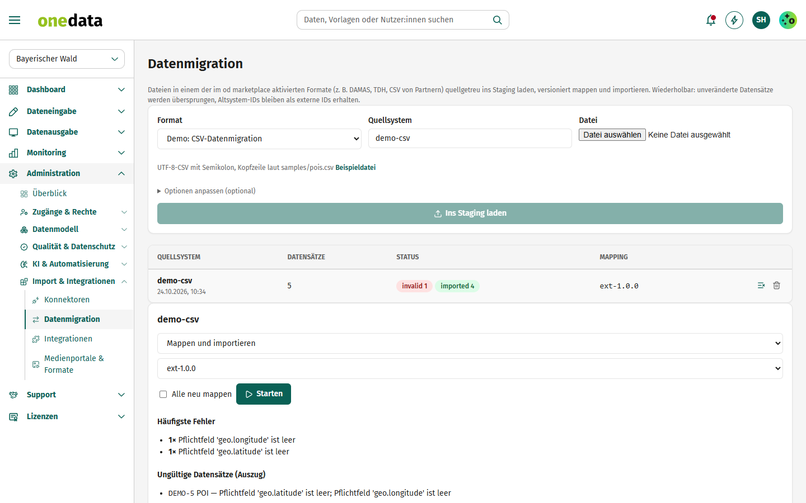

# Demo: CSV-Datenmigration

Vorlage für Partner, die ihr eigenes Dateiformat als **Datenmigration** in den od marketplace bringen möchten.

## Anbieter

**destination.one GmbH** – Hersteller von one.data, dem Redaktionssystem für Tourismusdestinationen.
Wir betreuen Destinationen, Landesmarketing-Organisationen und Partner bei der Anbindung ihrer Daten.

- Web: [www.destination.one](https://www.destination.one)
- Kontakt: [info@destination.one](mailto:info@destination.one)

## Kurzbeschreibung

Importiert Points of Interest aus einer Semikolon-CSV – mit Adresse, Koordinaten,
Kontakt, Kategorien und zweisprachigem Namen.

## Beschreibung

Diese Extension zeigt, wie ein Partner ein **eigenes Dateiformat** für die Datenmigration bereitstellt – ganz ohne
Programmcode. Sie besteht nur aus Konfiguration:

| Datei | Zweck |
|---|---|
| `extension.json` | Manifest: Art `import_format`, Parser `csv`, Optionen, Version |
| `mapping.json` | Zuordnung der CSV-Spalten zu den Feldern des one.data-Datenstandards |
| `samples/pois.csv` | Beispieldatei (in one.data unter *Datenmigration → Beispiel* herunterladbar) |
| `logo.png`, `screenshots/` | Darstellung im od marketplace |

### So funktioniert es

1. **Aktivieren:** Im od marketplace die Extension für die eigene Instanz aktivieren.
2. **Hochladen:** Unter *Administration → Datenmigration* das Format „Demo: CSV-Datenmigration“ wählen und die CSV hochladen.
   Die Datensätze landen quellgetreu im Staging (Quellsystem `demo-csv`).
3. **Mappen & importieren:** Die mitgelieferte Mapping-Version `ext-1.0.0` ist bereits ausgewählt. Ungültige Zeilen
   (im Beispiel `DEMO-5` ohne Koordinaten) erscheinen in der Fehlerliste.
4. **Wiederholen:** Erneute Uploads sind delta-fähig – nur geänderte Zeilen werden neu importiert.

### Spalten

`id`, `typ` (`POI`; weitere Typen über die Zuordnung in `mapping.json`), `name`, `name_en`, `kurztext`, `strasse`, `plz`, `ort`, `lat`, `lng`,
`telefon`, `email`, `website`, `kategorie` (kommagetrennt: `freizeit`, `natur`, `kultur`, `sport`).

### Eigene Extension daraus machen

Repo kopieren, `id` (eigene Domain rückwärts, z. B. `de.meinefirma.mein-format`), `name`, `publisher` und `version`
anpassen, Mapping ändern, Tag `v1.0.0` setzen – fertig. Leitfaden: *docs/EXTENSIONS.md* im one.data-Repo.
